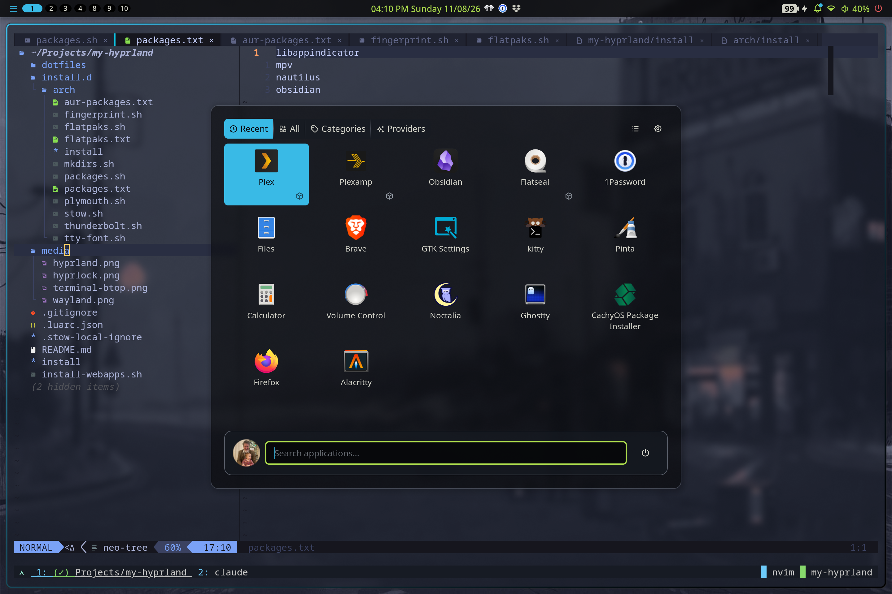

``` figlet
  __  __                 _   _                  _                 _ 
 |  \/  |_   _          | | | |_   _ _ __  _ __| | __ _ _ __   __| |
 | |\/| | | | |  _____  | |_| | | | | '_ \| '__| |/ _` | '_ \ / _` |
 | |  | | |_| | |_____| |  _  | |_| | |_) | |  | | (_| | | | | (_| |
 |_|  |_|\__, |         |_| |_|\__, | .__/|_|  |_|\__,_|_| |_|\__,_|
         |___/                 |___/|_|                             
```
<div align="center">
  
  
</div>

---

My [Hyprland](https://hyprland.org/) desktop, written in Hyprland's
[Lua configuration](https://wiki.hypr.land/Configuring/Start) and running the
[Noctalia](https://github.com/noctalia-dev/noctalia-shell) shell on CachyOS.

It started as a few extras on top of [Omarchy](https://omarchy.org), grew into a
standalone setup on NixOS, and now builds on CachyOS's Hyprland config. Noctalia
handles the bar, launcher, notifications, OSD, lock screen, clipboard, wallpaper
and theming. The earlier Waybar / Rofi / SwayNC setup is gone.

<div align="center">
  
</div>

## Features

- **Lua config split by concern.** Binds, monitors, workspaces, window rules and
  the look each have their own file under `.config/hypr/config/`.
- **Noctalia shell.** A minimal, square, flush bar plus the launcher, control
  center, notifications, clipboard history, screenshots, wallpaper picker and
  session menu, all driven by `noctalia msg`.
- **Theme-following borders.** Noctalia's generated colors are loaded into
  Hyprland at startup, so the active border's primary-to-surface gradient
  changes with the theme.
- **Three-monitor layout.** Laptop panel, Dell and BenQ, left to right. External
  monitors are matched by description, so they keep their settings on any dock
  port. Workspaces 1–3 are pinned to the BenQ.
- **AZERTY-safe workspace keys.** The number-row binds use physical keycodes, so
  they work on any keyboard layout.
- **Gaming workspace.** Steam and game windows go to a `gaming` workspace on the
  primary monitor, fullscreen and without decorations.
- **Touchpad gestures.** Swipe between workspaces, and close, fullscreen or
  float windows with gestures.
- **AirPods support.** [LibrePods](https://github.com/kavishdevar/librepods)
  runs as a user service, and Noctalia's bar shows an AirPods widget.
- **Per-OS installer.** Modules with hooks install and remove packages and
  services, the Plymouth boot splash, Thunderbolt, fingerprint unlock, and the
  stowed dotfiles.

---

## Installation

The installer works out which OS you're on and runs the matching
`install.d/<os>/install`. Right now only Arch-based systems are supported (Arch,
CachyOS, EndeavourOS, Manjaro).

**Prerequisites:** `git`, `stow`, `yay`, and the `sys-*` helpers from
[my-shell](https://github.com/TylerDurham/my-shell) (`sys-get-os`,
`sys-list-items`, `sys-select-items`) on your `PATH`. If `gum` is missing, the
installer installs it itself.

```bash
git clone https://github.com/TylerDurham/my-hyprland.git
cd my-hyprland

./install                  # run every module
./install --select         # choose which modules to run
./install --remove         # uninstall, in reverse order
```

### Modules (`install.d/arch/`)

| Module | Description |
|--------|-------------|
| `10-packages.sh` | Install packages from `10-packages.txt` (pacman) and `10-aur-packages.txt` (yay), plus `fzf`/`git`/`python`/`vim`/`zsh` outside CachyOS |
| `20-mkdirs.sh` | Create directories that stow should not own (`~/.local/share/my/bin`) |
| `30-stow.sh` | Symlink `dotfiles/` into `$HOME` with GNU stow |
| `40-brave.sh` | Install `brave-bin` and the managed browser policy in `40-brave.json` |
| `50-flatpaks.sh` | Install `flatpak`, add the Flathub remote and install the apps in `50-flatpaks.txt` |
| `60-thunderbolt.sh` | Install `bolt` and enable `bolt.service` so Thunderbolt devices can be authorized |
| `70-tty-font.sh` | Set the console font to Terminus (`ter-132b`) and rebuild the initramfs so the LUKS prompt uses it |
| `80-plymouth.sh` | Themed boot splash from [adi1090x/plymouth-themes](https://github.com/adi1090x/plymouth-themes), mkinitcpio hook, silent-boot kernel params |
| `90-fingerprint.sh` | **Opt-in.** Enroll fingerprints and add `pam_fprintd` to sudo and polkit. Only runs when picked with `--select` |

Modules run in filename order and are removed in reverse, so the numeric
prefix sets the order. Each module defines `on_init`, `on_install` and `on_uninstall` hooks, plus an
optional `on_completed`. Modules can be re-run safely, because each step checks
the current state before changing anything.

**Module knobs**

| Variable | Module | Effect |
|----------|--------|--------|
| `PLYMOUTH_PRESET` | plymouth | Theme preset: `lone` (default), `rings`, `cuts`, `circuit`, `connect` |
| `FINGERS` | fingerprint | Fingers to enroll, e.g. `"right-index-finger left-thumb"` |
| `ENROLL_ONLY=1` | fingerprint | Re-enroll fingers without touching PAM |
| `WIRE_LOGIN=1` | fingerprint | Also wire up the SDDM greeter |
| `SCOPE=user` | flatpaks | Install flatpaks per-user instead of system-wide |
| `NO_CONFIRM=1` | plymouth, thunderbolt, flatpaks | Skip pacman's (and flatpak's) confirmation prompts |

### Web apps (optional)

`install-webapps.sh` installs a few browser-backed desktop entries (Excalidraw,
Logos, Gitea, GitHub, Claude.ai, LitCharts) using `hypr-install-webapp`:

```bash
./install-webapps.sh
```

---

## Keybinds

> Press **`SUPER + K`** to open Noctalia's keybind cheatsheet.

### Applications & Shell

| Keybind | Action |
|---------|--------|
| `SUPER + Return` | Terminal (kitty) |
| `SUPER + E` | File manager (Nautilus) |
| `SUPER + W` | Browser (Brave) |
| `SUPER + T` | Text editor |
| `SUPER + C` / `XF86Calculator` | Calculator |
| `CTRL + SHIFT + Escape` | btop |
| `SUPER + Space` | Launcher |
| `SUPER + .` | Emoji picker |
| `SUPER + Tab` | Window switcher |
| `SUPER + X` | Control center |
| `SUPER + A` | Notifications |
| `SUPER + V` | Clipboard history |
| `SUPER + Z` | Noctalia settings |
| `SUPER + SHIFT + W` | Wallpaper picker |
| `SUPER + L` | Lock screen |
| `SUPER + ALT + C` | Session menu |

### Windows

| Keybind | Action |
|---------|--------|
| `SUPER + Q` | Close window |
| `SUPER + Escape` | Kill window (`hyprctl kill`) |
| `SUPER + F` | Fullscreen |
| `SUPER + D` | Maximize |
| `SUPER + ALT + Space` | Toggle floating |
| `SUPER + J` | Toggle split |
| `SUPER + ←↑→↓` | Move focus |
| `ALT + Tab` | Cycle windows |
| `SUPER + SHIFT + ←↑→↓` | Move window |
| `SUPER + LMB / RMB drag` | Move / resize window |
| `SUPER + -` / `SUPER + +` | Zoom out / in |

### Workspaces & Monitors

| Keybind | Action |
|---------|--------|
| `SUPER + 1–0` | Go to workspace 1–10 |
| `SUPER + CTRL + 1–0` | Go to workspace N on the current monitor |
| `SUPER + CTRL + ←/→` | Previous / next workspace on the monitor |
| `SUPER + CTRL + ↓` | Next empty workspace on the monitor |
| `SUPER + SHIFT + 1–0` | Move window to workspace and follow it |
| `SUPER + SHIFT + CTRL + 1–0` | Move window to workspace silently |
| `SUPER + CTRL + SHIFT + ←/→` | Move window to previous / next workspace |
| `SUPER + ALT + 1/2/3` | Focus laptop / Dell / BenQ monitor |
| `SUPER + SHIFT + ALT + 1/2/3` | Move window to laptop / Dell / BenQ monitor |
| `SUPER + S` | Toggle scratchpad |
| `SUPER + SHIFT + S` | Move window to scratchpad |
| `SUPER + scroll` | Cycle workspaces |

### Utilities & Hardware

| Keybind | Action |
|---------|--------|
| `Print` | Screenshot region |
| `SUPER + Print` | Screenshot full screen |
| `SUPER + P` | Color picker (`hyprpicker`) |
| Volume / mic / brightness keys | Handled by Noctalia (with OSD), work while locked |
| Media keys | Play/pause, next, previous through Noctalia |

### Touchpad Gestures

| Gesture | Action |
|---------|--------|
| 4-finger swipe left/right | Switch workspace |
| 3-finger swipe down | Close window |
| 3-finger swipe up | Fullscreen |
| 3-finger swipe left | Toggle floating |

---

## Project Structure

```
.
├── install                       # OS detection → install.d/<os>/install
├── install-webapps.sh            # Optional web app desktop entries
├── install.d/
│   └── arch/
│       ├── install               # Module runner (hooks, --select, --remove)
│       └── *.sh                  # Modules (see table above)
├── media/                        # README images
└── dotfiles/                     # Stowed into $HOME
    ├── .config/
    │   ├── hypr/
    │   │   ├── hyprland.lua      # Entry point; loads config/* and Noctalia colors
    │   │   ├── xdph.conf         # xdg-desktop-portal-hyprland settings
    │   │   └── config/
    │   │       ├── animations.lua
    │   │       ├── autostart.lua     # dbus env, Noctalia
    │   │       ├── binds.lua         # All keybinds
    │   │       ├── colors.lua        # CachyOS palette constants
    │   │       ├── decorations.lua   # Gaps, borders, rounding, blur, opacity
    │   │       ├── environment.lua   # hl.env (unused under UWSM)
    │   │       ├── inputs.lua        # Input + touchpad gestures
    │   │       ├── misc.lua          # dwindle, VRR, swallow, xwayland
    │   │       ├── monitors.lua      # Three-monitor layout
    │   │       ├── variables.lua     # Default apps, monitor names, workspace count
    │   │       ├── windowrules.lua   # Window + Noctalia layer rules
    │   │       └── workspaces.lua    # Workspace-to-monitor pinning
    │   ├── noctalia/config.toml  # Bar, panels, session menu, theme templates
    │   ├── uwsm/env              # Session environment (cursor, Qt, Electron)
    │   ├── autostart/            # XDG autostart (1Password, Dropbox)
    │   ├── systemd/user/         # librepods.service
    │   └── mimeapps.list
    └── .local/share/my/
        ├── bin/                  # dropbox-login, hypr-install-webapp, hypr-launch-webapp
        └── themes/               # Legacy theme packs from the pre-Noctalia setup
```

---

## Customisation

**Default apps, monitors and workspace count** are in
`.config/hypr/config/variables.lua`:

```lua
TERMINAL     = "kitty"
FILE_MANAGER = "nautilus"
BROWSER      = "brave"
EDITOR       = "gnome-text-editor --new-window"
CALCULATOR   = "gnome-calculator"

MONITOR1 = "eDP-1"                                -- laptop panel (left)
MONITOR2 = "desc:Dell Inc. DELL S2725QS 7DCMT84"  -- Dell (middle)
MONITOR3 = "desc:BNQ BenQ RD280UG EMF6T00620087"  -- BenQ (right)
PRIMARY_MONITOR = MONITOR3

NUM_WPM = 10
```

To match a different monitor by description, find its string with
`hyprctl monitors`, then set modes and positions in `monitors.lua`.

**Session environment variables** go in `.config/uwsm/env`. Apps are launched
through `uwsm app --`. If you don't use UWSM, clear `launchPrefix` in
`binds.lua` and set the variables in `environment.lua` instead.

**Theme, bar and panels** are set in Noctalia's settings (`SUPER + Z`), which
saves them to `.config/noctalia/config.toml`.

---

## Related

| Repo | Description |
|------|-------------|
| [my-shell](https://github.com/TylerDurham/my-shell) | Shell dotfiles and the `sys-*` helpers the installer uses |
| [my-nixos](https://github.com/TylerDurham/my-nixos) | NixOS dotfiles |
| [my-neovim](https://github.com/TylerDurham/my-neovim) | Neovim config |

---

## License

MIT
